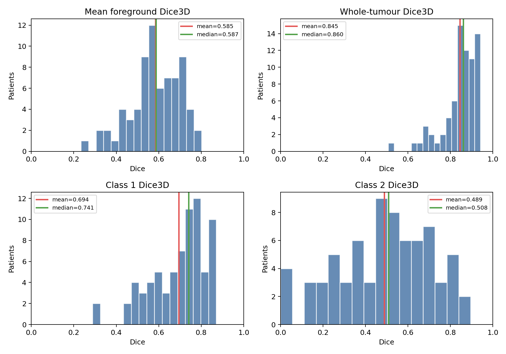
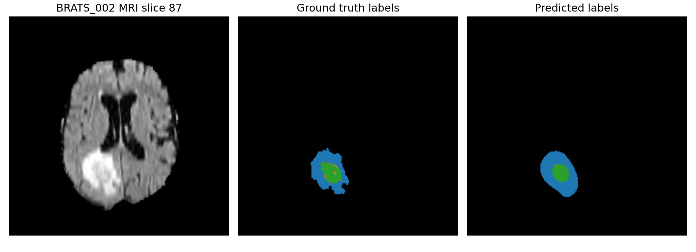

# CNN-ViT 4-Label Tumour Segmentation Report

## Objective

This experiment extends the binary CNN-ViT tumour segmentation model to multiclass 4-label segmentation on the MSD Task01 BrainTumour dataset.

The prediction target is:

| Class | Meaning                                        |
| ----: | ---------------------------------------------- |
|     0 | background                                     |
|     1 | tumour subregion label 1 (edema)               |
|     2 | tumour subregion label 2 (non-enhancing tumor) |
|     3 | tumour subregion label 3 (enhancing tumour)    |

## Model

The model is based on the pretrained hybrid CNN-ViT:

https://huggingface.co/timm/vit_base_r50_s16_224.orig_in21k

The base architecture is a ResNetV2-50 hybrid Vision Transformer with ViT-B hidden width:

- input stem: ResNetV2 hybrid CNN backbone
- token grid under Route B: `15 x 15`
- Transformer embedding dimension: `768`
- Transformer depth: 12 blocks
- decoder: lightweight upsampling segmentation head

The 4-label version preserves the Route B native-resolution design:

```text
4 x 240 x 240 MRI slice
        -> hybrid CNN-ViT encoder
        -> 15 x 15 token feature grid
        -> decoder
        -> 4 x 240 x 240 logits
```

The final prediction is obtained by:

```text
argmax(logits, dim=class)
```

Therefore the model outputs one integer label map per slice with values in `{0,1,2,3}`.

## Adaptation From Pretrained CNN-ViT

The pretrained model was originally trained on 3-channel 224x224 natural images. The following adaptations were used:

1. **Input channels: 3 -> 4**

   The first convolution was adapted from RGB to four MRI modalities by averaging the pretrained RGB kernels and repeating the averaged kernel across 4 input channels, with scaling to preserve activation magnitude.

2. **Input resolution: 224 -> 240**

   Route B keeps the original MRI grid at `240 x 240`. This avoids prediction-space resizing before volumetric evaluation.

3. **Positional embedding: 14 x 14 -> 15 x 15**

   The pretrained image-token positional embeddings were reshaped from:

   ```text
   196 = 14 x 14 tokens
   ```

   to a 2D grid, bicubic-interpolated to:

   ```text
   225 = 15 x 15 tokens
   ```

   and concatenated back with the unchanged CLS positional token.

4. **Decoder head: 1 binary channel -> 4 multiclass channels**

   The segmentation head outputs 4 logits per pixel. The encoder geometry and decoder upsampling path remain otherwise unchanged.

## Training Setup

The frozen patient split was reused from the binary model:

| Split | Patients |
|---|---:|
| Train | 339 |
| Validation | 72 |
| Test | 73 |

Training expanded the train patients into all 2D slices:

```text
339 patients x 155 slices = 52,545 train slices
72 patients x 155 slices = 11,160 validation slices
```

The full-validation setting was confirmed in the saved metadata:

```text
max_train_steps_per_epoch = null
max_val_steps_per_epoch = null
max_val_patients = null
max_slices_per_val_patient = null
require_full_val = true
```

The model was trained with:

| Setting | Value |
|---|---:|
| batch size | 16 |
| GPUs | 2 x Tesla T4 via DataParallel |
| AMP | enabled, FP16 |
| sampler | patient-local slice ordering |
| balanced sampler | false |
| trainable parameters | 42,515,940 |
| total parameters | 101,442,276 |

The unfrozen components were:

- decoder
- adapted input stem
- positional embedding
- ResNet stage 2
- final 4 ViT blocks
- encoder norm

Learning rates:

| Parameter group | LR |
|---|---:|
| decoder / stem | `3e-4` |
| ResNet stage 2 / ViT blocks | `3e-5` |
| positional embedding | `3e-5` |

## Loss

The 4-label model was trained with:

```text
L = 0.5 * CE + 0.5 * foreground Dice loss
```

Cross-entropy is computed over all four classes, including background.

The Dice component averages only foreground classes:

```text
L_Dice = 1 - mean(Dice_1, Dice_2, Dice_3)
```

This prevents the dominant background class from artificially inflating the Dice term.

## Validation Metrics and Checkpoint Selection

Validation reconstructs complete patient volumes from 155 predicted slices and computes patient-level 3D metrics.

For each foreground class `c`:

```text
Dice_c = (2 |P_c intersect G_c| + eps) / (|P_c| + |G_c| + eps)
```

The primary checkpoint metric is:

```text
patient_mean_fg_dice3d = mean(Dice_1, Dice_2, Dice_3)
```

with patient-level macro averaging.

Whole-tumour metrics are also reported by collapsing labels 1/2/3 into foreground.

Absent-class handling:

- GT absent and prediction absent: excluded from class Dice macro average
- GT absent and prediction present: Dice = 0
- class RVE is NaN when GT class volume is zero

## Validation Results

The best checkpoint was selected at epoch 4.

| Epoch | Val loss | Patient mean FG Dice3D | Whole Dice3D | Whole RVE |
|---:|---:|---:|---:|---:|
| 1 | 0.4222 | 0.5044 | 0.8259 | 0.1177 |
| 2 | 0.4071 | 0.5804 | 0.8391 | 0.1190 |
| 3 | 0.4043 | 0.5921 | 0.8453 | 0.1068 |
| 4 | 0.4025 | **0.5990** | **0.8500** | **0.0990** |

Class-wise validation Dice3D at the selected checkpoint:

| Class | Mean Dice3D | Mean RVE |
|---:|---:|---:|
| 1 | 0.7064 | 0.2345 |
| 2 | 0.4467 | 0.9868 |
| 3 | 0.6438 | 0.3319 |

Class 2 is the main bottleneck. Its mean Dice3D is substantially lower than classes 1 and 3, and its RVE remains high.


## Held-Out Test Results

Final inference was run on the frozen 73-patient held-out test split using:

- checkpoint: `route-b-4label-full-train/best_checkpoint.pt`
- thresholding: not applicable; multiclass `argmax`
- GPUs: 2 x Tesla T4
- AMP: enabled
- saved outputs: 4-label NIfTI predictions

Test summary:

| Metric | Mean | Median |
|---|---:|---:|
| Mean foreground Dice3D | **0.5852** | **0.5873** |
| Whole-tumour Dice3D | **0.8452** | **0.8601** |
| Whole-tumour RVE | **13.37%** | **8.90%** |
| Class 1 Dice3D | 0.6941 | 0.7405 |
| Class 2 Dice3D | 0.4890 | 0.5081 |
| Class 3 Dice3D | 0.5726 | 0.6661 |
| Class 1 RVE | 27.40% | 15.76% |
| Class 2 RVE | 76.28% | 40.22% |
| Class 3 RVE | 33.38% | 24.00% |

Runtime:

```text
73 patients
207.2 seconds total model inference time
212.1 seconds wall time
2.84 seconds per patient
```

The whole-tumour Dice remains close to the binary CNN-ViT model, but the foreground-subregion metric is much harder. This is expected because class-wise segmentation requires the model to identify internal tumour subregions, not only tumour-vs-background.



Representative 4-label slice:



## Stage 2 Unfreezing Experiment

A follow-up experiment tested whether further unfreezing improves the 4-label model.

Starting point:

```text
epoch-4 best checkpoint
patient_mean_fg_dice3d = 0.5990
whole_dice3d = 0.8500
whole_rve = 9.90%
```

Stage 2 settings:

| Setting | Stage 1 | Stage 2 |
|---|---:|---:|
| initialization | ImageNet-21k | epoch-4 4-label checkpoint |
| trainable ViT blocks | 4 | 8 |
| trainable ResNet stages | `2` | `2` |
| decoder/stem LR | `3e-4` | `3e-5` |
| pretrained LR | `3e-5` | `3e-6` |
| pos embed LR | `3e-5` | `3e-6` |

The run did not complete a full epoch because Kaggle RAM became saturated. No complete CSV/JSON checkpoint-selection output was produced for this run.

However, the partial logs are sufficient for diagnosis. Training loss rapidly plateaued around `0.198-0.200`, while partial validation loss over the first 500/698 validation batches stayed around `0.390-0.401`.

Excerpt:

```text
[train] step 250/3285  loss=0.2154 throughput=38.38 slices/s
[train] step 500/3285  loss=0.2024 throughput=38.53 slices/s
[train] step 1750/3285 loss=0.1998 throughput=38.22 slices/s
[train] step 3250/3285 loss=0.1985 throughput=38.13 slices/s

[val] step 50/698  loss=0.4012
[val] step 100/698 loss=0.3900
[val] step 250/698 loss=0.3939
[val] step 500/698 loss=0.3962
```

The existing epoch-4 model already had full-validation loss:

```text
val_loss = 0.4025
patient_mean_fg_dice3d = 0.5990
```

Since the Stage 2 partial validation loss did not show a clear improvement and the run did not produce a full patient-level 3D Dice evaluation, it does not justify replacing the frozen epoch-4 checkpoint. The experiment supports closing the 4-label line with the Stage 1 selected model.

## Interpretation

The 4-label CNN-ViT successfully learned multiclass tumour subregion segmentation and preserved strong whole-tumour performance:

```text
test whole Dice3D = 0.845
test whole RVE median = 8.90%
```

However, subregion segmentation is substantially harder:

```text
test mean foreground Dice3D = 0.585
```

The main error source is class 2, which has:

```text
test class 2 Dice3D mean = 0.489
test class 2 RVE mean = 76.3%
```

This suggests that the model is reliable for whole-tumour segmentation and volumetry, but subregion-level volume estimates should be interpreted more cautiously, especially for smaller or less spatially distinct subclasses.

## Final Decision

The 4-label Route B CNN-ViT is closed with the epoch-4 checkpoint:

```text
PBL_BrainTumour/outputs/full_train_weights_4label/best_checkpoint.pt
```

Final held-out test performance:

```text
N_test = 73
mean foreground Dice3D = 0.585
median foreground Dice3D = 0.587
whole-tumour Dice3D mean = 0.845
whole-tumour Dice3D median = 0.860
whole-tumour RVE mean = 13.37%
whole-tumour RVE median = 8.90%
```

The deeper-unfreezing Stage 2 run is recorded as an exploratory inconclusive/neutral result and is not used for final model selection.

