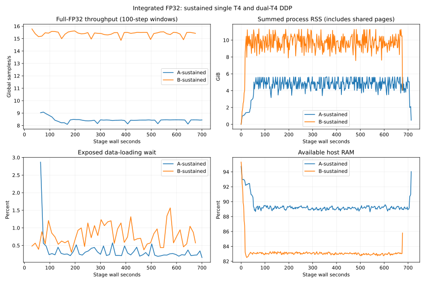

# Integrated full-FP32 results — 2026-11-18

**Sustained training, new-process continuation, native export and private recovery are verified.** One GPU campaign ran; its final export failed on a known metadata contract mismatch. The approved CPU correction completed export from existing logits and restored checkpoints, without another GPU job or inference. The original GPU Actions status remains failure; the CPU recovery status is success. This is an execution-system acceptance, not model-quality or full-cohort training acceptance.

[Implementation PR #24](https://github.com/Strange-Noah/BrainTumour-CNNViT-Segmentation/pull/24), merged source `d8ac3240b58a193cce79636695153396f9bdddd2` · [GPU run 44292134002](https://github.com/Strange-Noah/BrainTumour-CNNViT-Segmentation/actions/runs/44292134002) · [CPU correction PR #25](https://github.com/Strange-Noah/BrainTumour-CNNViT-Segmentation/pull/25), merged source `8a0276a96e8f313c28a72897b53b4d9708d93a17` · [CPU recovery 44333112852](https://github.com/Strange-Noah/BrainTumour-CNNViT-Segmentation/actions/runs/44333112852).

## Actual sustained measurements

| Measurement | Single T4 | Dual T4 DDP |
|---|---:|---:|
| Full-FP32 global throughput | 8.439 samples/s | 15.403 samples/s |
| Measured steady duration | 647.83 s | 657.78 s |
| Local / global batch | 1 / 1 | 1 / 2 |
| Successful optimizer updates | 5,477 | 5,076 per rank |
| Late rank-0 throughput | 8.413 samples/s | 7.699 samples/s |
| Exposed loader wait | 0.343% | 0.799% |
| Cache hit fraction | 87.68% | 87.66% |
| Peak summed process RSS | 5.65 GiB | 11.33 GiB |
| Minimum available host RAM | 88.64% | 82.51% |
| Late/middle RSS median ratio | 0.996 | 0.991 |
| Swap-in increase | 0 | 0 |
| Peak CUDA allocated memory | 762 MiB | 857 MiB per rank |

DDP sustained speedup is **1.825×**, with approximately 91.3% of ideal two-device sample throughput scaling. Global batch doubles; this is a throughput comparison, not proof of identical optimization trajectories. No numerical failure was observed during these stages. RSS oscillated within bounded cache turnover without sustained growth or RAM pressure; summed RSS double-counts shared mmap pages.

Data loading is now a small exposed wait rather than the dominant bottleneck. Forward plus backward/synchronization accounted for about 89% of measured iteration time. Compared with the earlier partial run's roughly 64% loader wait, the observed wait is below 1%, but precision/order/duration also changed; this is not a controlled single-variable GPU speedup experiment.

[Aggregate measurements](evidence/integrated-fp32/performance.json). Complete step/system logs, model tensors and patient outputs remain private.

## Continuation and validation

A new DDP process restored the healthy sustained checkpoint at update 5,076, verified model tensors, optimizer moments/steps, per-rank RNG and next sampler draws, then completed four updates through **5,080**. [Continuation receipt](evidence/integrated-fp32/resume.json).

The same GPU campaign completed finite-logit inference and metric evaluation for one held-out validation visit. Shared export then rejected missing split provenance. This launch-time oversight was corrected in PR #25 with three synthetic shared-contract tests. A free CPU Actions job recovered all three healthy checkpoints, reused the already computed logits, verified frozen validation membership and split SHA, completed native binary NIfTI export, checked shape/affine/voxels/units and verified the private outputs using a new R2 client. There was no repeated GPU inference or training. One visit and this bounded run do not establish segmentation accuracy; no test-partition evaluation or full-cohort training was performed.

## Persistent recovery and quota

All **53** GPU output files were written/readback-verified in private R2. GPU collection receipt `novo-nordisk/experiments/unet25d/bridge/44292134002/collection.json`, SHA `925681c67dd8b14f75fdad28b98f4b09c89937a9979d3577eb1753357517f38e`.

CPU repair receipt `novo-nordisk/experiments/unet25d/bridge/44292134002/cpu-recovery/44333112852/report.json`, SHA `b4bf5e24d76622ac84fa214a3177f6acefe6fd9391a816897f97fdfbb92d87d1` (1,019 bytes). [Aggregate recovery evidence](evidence/integrated-fp32/recovery.json).

Account GPU quota increased **0.33 → 0.78 hours**, a 0.45-hour charge for this campaign; 29.22 hours remained. Cumulative observed account use is 46.8 minutes, within the original 60-minute campaign envelope. Platform cap was 2,100 seconds. Account quota, session wall time and summed two-device time are distinct. No paid compute or further GPU job was launched.

## Recommended initial formal-training configuration

Use **dual T4 DDP, full FP32, local batch 1/global batch 2**, one persistent worker per rank, prefetch 2, at most two mmap visits and 3 GiB mapped files per worker, deterministic 64-draw per-rank locality windows. Keep TF32/autocast/GradScaler off. Keep SMP 0.5.0 U-Net/ResNet34, pinned ImageNet initialization, all parameters trainable, encoder BN running statistics frozen, decoder BN training, 12 modality-major channels, 512×512 and the existing label-3 target. Retain AdamW encoder/decoder LR 1e-4/3e-4, weight decay 1e-4 and equal BCE/soft-Dice loss. Original cache/preprocessing/split bytes are unchanged; effective runtime policy is checkpointed.

This recommendation uses measured robust execution rather than maximum theoretical utilization. Mixed precision and larger batches are deferred. The runtime image recorded by Kaggle was `gcr.io/kaggle-private-byod/python@sha256:de153e6d303881930c51286216393d56f56b26458d0661350305a1e8144eea01`; GPU Torch version was not separately emitted, so the image digest is retained rather than inventing a package version.

**Stop before formal full-cohort training.** Remaining decisions are authorization for the full run and its duration/checkpoint schedule, full-cohort prepared input/storage arrangement, and handling oversized/native-grid conflicts. Those six examinations did not block this benchmark. Hosted deployment is independent. No more GPU work is authorized by this report.
