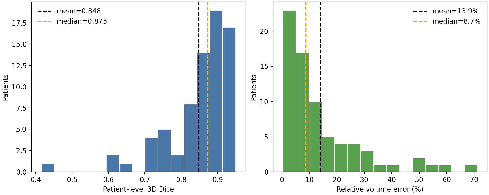
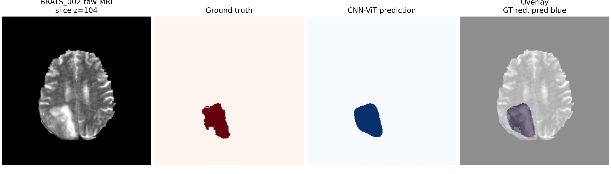

# CNN-ViT Brain Tumour Segmentation Report

## 1. Model Overview

This experiment used a pretrained hybrid CNN-ViT backbone:

- Model page: [timm/vit_base_r50_s16_224.orig_in21k](https://huggingface.co/timm/vit_base_r50_s16_224.orig_in21k)
- Backbone type: ResNet-50 + Vision Transformer hybrid
- Original pretraining: ImageNet-21k
- Original input setting: RGB, 224 x 224
- ViT hidden dimension: 768
- ViT depth: 12 transformer blocks
- Original token grid at 224 x 224: 14 x 14 image tokens plus one CLS token

The original pretrained model is an image classification / feature backbone. For this project, it was converted into a 2D slice-wise tumour segmentation model for 4-channel brain MRI.

## 2. Adaptation

The final CNN-ViT model used the native-resolution design:

```text
Input MRI slice:      (4, 240, 240)
Hybrid CNN encoder:   15 x 15 feature grid
ViT sequence:         225 image tokens + 1 CLS token
Decoder output:       (1, 240, 240)
```

The adapted model operates directly on the native 240 $\times$ 240 slices. The resulting 15 $\times$ 15 hybrid feature grid is accommodated by interpolating the pretrained positional embeddings, and the decoder restores logits directly to 240 $\times$ 240, avoiding an explicit image/label resize to the original 224-pixel pretraining resolution.

### 2.1 Four-channel MRI input

The pretrained model expected 3-channel RGB input, but the brain tumour data contains four MRI modalities. Instead of forcing four modalities into three channels, the first convolution was adapted from:

```text
Conv2d input: 3 channels -> 4 channels
```

The pretrained RGB kernels were averaged across the original input-channel dimension and repeated to four channels, with scaling to preserve the approximate activation magnitude. This retained the pretrained spatial filters while allowing all MRI modalities to remain explicit.

### 2.2 Positional embedding interpolation

The original model was pretrained at 224 x 224:

```text
224 / 16 = 14
14 x 14 = 196 image tokens
196 + CLS = 197 total tokens
```

For native 240 x 240 inference:

```text
240 / 16 = 15
15 x 15 = 225 image tokens
225 + CLS = 226 total tokens
```

Only the image-token part of the pretrained positional embedding was interpolated:

```text
(1, 197, 768)
-> CLS token:       (1, 1, 768), kept unchanged
-> image tokens:    (1, 196, 768)
-> reshape:         (14, 14, 768)
-> bicubic interp:  (15, 15, 768)
-> flatten:         (1, 225, 768)
-> concatenate:     (1, 226, 768)
```

This changes the positional embedding tensor length but does not change the Transformer block weight shapes. The attention/MLP/LayerNorm parameters remain compatible because they operate over the embedding dimension, not over a fixed number of tokens.

### 2.3 Segmentation decoder

The ViT image tokens are reshaped back into a spatial feature map:

```text
(B, 225, 768) -> (B, 768, 15, 15)
```

A lightweight upsampling decoder then recovers full-resolution logits:

```text
15 -> 30 -> 60 -> 120 -> 240
```

The model outputs raw logits:

```text
(B, 1, 240, 240)
```

Sigmoid and thresholding are applied outside the model during validation/inference.

## 3. Fine-tuning Protocol

The frozen split was patient-level and tumour-volume stratified:

```text
Train: 339 patients
Validation: 72 patients
Test: 73 patients
```

The same frozen split was used for training, validation, and final held-out testing.

The confirmed trainable components were:

- Segmentation decoder
- Adapted input stem
- Positional embedding
- ResNet stage 2
- Last 4 ViT transformer blocks
- Final encoder norm

The rest of the pretrained backbone was frozen.

From `training_metadata.json`:

```text
Total parameters:     101,442,129
Trainable parameters:  42,515,793
Frozen parameters:     58,926,336
```

Training used:

```text
Batch size: 16
GPU: dual Tesla T4 with DataParallel
AMP: enabled, float16
Train sampler: patient-local shuffled sampler
Loss: 0.5 BCEWithLogits + 0.5 soft Dice loss
Threshold for validation/test masks: 0.5
```

Training loss remained 2D slice-wise. Model selection used validation patient-level 3D Dice when complete validation volumes were available.

## 4. Training and Validation Results

Training ran for two full epochs. Each epoch used all 52,545 train slices and all 11,160 validation slices.

| Epoch | Phase | Loss | Slice Dice | Patient 3D Dice Mean | Patient 3D Dice Median | Mean RVE | Median RVE |
|---:|---|---:|---:|---:|---:|---:|---:|
| 1 | Train | 0.1493 | 0.8000 | - | - | - | - |
| 1 | Val | 0.3205 | 0.8009 | 0.8441 | 0.8658 | 10.68% | 9.90% |
| 2 | Train | 0.0885 | 0.8433 | - | - | - | - |
| 2 | Val | 0.3193 | 0.8264 | 0.8476 | 0.8748 | 12.44% | 8.24% |

The best checkpoint was selected at epoch 2 by validation patient-level 3D Dice.

Training curve:


## 5. Held-out Test Results

Final inference was run once on the 73 frozen test patients. These patients were not used for training or checkpoint selection.

From `outputs/model_infer/test_summary.json`:

```text
N_test:                  73 patients
Mean 3D Dice:            0.8481
Median 3D Dice:          0.8725
Mean RVE:                13.94%
Median RVE:              8.75%
Wall-clock inference:    184.26 s
Mean inference time:     2.46 s / patient
```

The validation-to-test gap was negligible:

```text
Validation mean 3D Dice: 0.8476
Test mean 3D Dice:       0.8481
Difference:             +0.0005
```

This supports that the epoch-2 checkpoint generalized well under the frozen patient-level split.

Test metric distributions:



## 6. Example Segmentation

The following example uses `BRATS_002` from the held-out test split. The displayed slice is the axial slice with the largest ground-truth tumour area for this patient.



For `BRATS_002`:

```text
3D Dice:      0.8803
GT volume:    63.061 cm3
Pred volume:  68.578 cm3
RVE:           8.75%
```

## 7. Case-level Observations

The test distribution was not uniform. The median Dice was higher than the mean, indicating that a small number of difficult cases pulled the mean downward.

Worst cases by 3D Dice:

| Case | Dice3D | RVE | GT volume (cm3) | Pred volume (cm3) |
|---|---:|---:|---:|---:|
| BRATS_062 | 0.415 | 60.6% | 57.234 | 22.523 |
| BRATS_077 | 0.599 | 52.8% | 36.579 | 17.263 |
| BRATS_197 | 0.616 | 47.7% | 113.287 | 59.237 |
| BRATS_053 | 0.641 | 47.8% | 74.288 | 38.797 |
| BRATS_304 | 0.706 | 3.1% | 44.582 | 43.194 |

`BRATS_304` is especially useful for interpretation: its Dice score was relatively low, but its volume error was only 3.1%. This shows that spatial overlap and volumetric accuracy are related but not identical endpoints.

Best cases by 3D Dice:

| Case | Dice3D | RVE | GT volume (cm3) | Pred volume (cm3) |
|---|---:|---:|---:|---:|
| BRATS_143 | 0.949 | 2.3% | 116.498 | 119.212 |
| BRATS_172 | 0.944 | 1.3% | 143.966 | 145.778 |
| BRATS_202 | 0.941 | 1.1% | 215.492 | 217.848 |
| BRATS_471 | 0.936 | 2.0% | 204.242 | 208.289 |
| BRATS_022 | 0.936 | 5.7% | 248.231 | 234.193 |

## 8. Provenance and Reproducibility

Final training used:

```text
Split SHA256:       6e531e7de58dc45dc808a76843417c32ece58df1421fa00a14f342f15d716869
Checkpoint SHA256:  e1b256d3ee35cd8c66b62fdf5e08cc380e99234c7e3cbf8cd85c288142d9d783
Threshold:          0.5
Inference mode:     frozen 73-patient test split
Inference hardware: dual Tesla T4, DataParallel, AMP float16
```

The test threshold was fixed at 0.5 before final testing and was not tuned on test results.

## 9. Conclusion

Route B CNN-ViT is complete and ready to freeze as the primary CNN-ViT baseline:

```text
Mean held-out 3D Dice:     0.848
Median held-out 3D Dice:   0.873
Mean RVE:                  13.9%
Median RVE:                 8.75%
Inference speed:            2.46 s / patient
```

The model achieved strong held-out segmentation performance with essentially no validation-to-test degradation. Further tuning of this model after seeing test performance is not recommended. Additional compute should be used for predefined comparator models, such as PCA-ViT, rather than further modifying this finalized CNN-ViT result.

## References

- Hugging Face model page: [timm/vit_base_r50_s16_224.orig_in21k](https://huggingface.co/timm/vit_base_r50_s16_224.orig_in21k)
- ViT paper: [An Image is Worth 16x16 Words: Transformers for Image Recognition at Scale](https://arxiv.org/abs/2010.11929)
