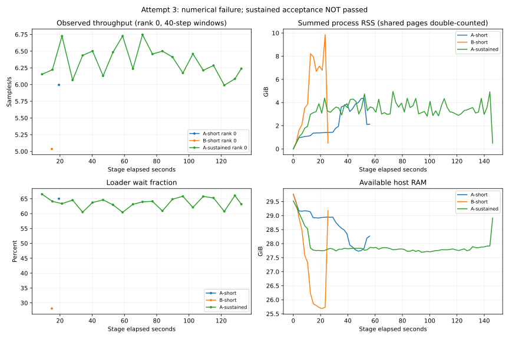

# Bounded GPU attempt 3 — acceptance remains open

The selective-FP32 continuation discussed below is historical. The owner has superseded it with the [full-FP32 integrated strategy](INTEGRATED_FP32.md).

The owner approved PR #23 revision `e1a916b8eba609187197b86947803bf176bdd12b`. It merged as [5f0eee17ba10927fc267903e2a6ba1cd23499fc6](https://github.com/Strange-Noah/BrainTumour-CNNViT-Segmentation/commit/5f0eee17ba10927fc267903e2a6ba1cd23499fc6). [Actions run 44255895457](https://github.com/Strange-Noah/BrainTumour-CNNViT-Segmentation/actions/runs/44255895457) dispatched the private Kaggle notebook from that exact integrated source with a 2,400-second cap. Submission source and private metadata were read back. Existing private cache version 1 was reused; no preprocessing or full-cohort training ran.

The GPU session stopped early with **nonfinite forward loss**. It did not reach ten-minute sustained acceptance, sustained DDP, worker/batch tuning, validation or resume continuation. Do not select the final formal training configuration from these partial results. No further GPU run was launched.

## Actual measurements

| Stage | Global samples/s | Steady seconds | Loader wait | Peak summed RSS |
|---|---:|---:|---:|---:|
| Single short | 5.995 | 6.67 | 65.0% | 4.37 GiB |
| DDP short, 2 × T4 | 10.072 | 7.94 | 36.8% | 9.86 GiB |
| Single longer stage (failed) | 6.340 | 130.13 | 63.7% | 4.95 GiB |

Matched short-test DDP/single speedup is **1.680×**. These approximately seven-second steady windows do not establish sustained speedup. Report-generated speedup against A-sustained uses a different duration and must not be mistaken for a matched comparison. GPU allocation peaks were about 573 MiB for single and 667 MiB per DDP rank (CUDA allocator; distinct from nvidia-smi process/device usage). Sampled nvidia-smi device-memory peaks were 765 MiB for single and 951 MiB per DDP device.

During the longer single stage, available host RAM stayed above 27.69 GiB; swap-in remained zero. The final/middle summed-RSS median ratio was 0.926. This is a short observation, not ten-minute RAM acceptance; summed RSS double-counts mmap pages. Loader wait dominated single throughput. Backward timers include DDP synchronization and do not isolate communication overlap. The bounded eight-train-patient cache does not predict cold-I/O full-cohort performance.

[Measured aggregate JSON](evidence/gpu-attempt-3/performance.json) and [whitelisted timing/memory summaries](evidence/gpu-attempt-3/telemetry-aggregate.json) are public; complete step/system logs remain exclusively in the private R2 collection. No imaging, patient identifiers, checkpoint bytes or credentials are committed.

## Checkpoint and persistence evidence

The failed checkpoint records step **835**, draw position **835**, and AdamW step **835**. This confirms PR #23's metadata-counter correction. The last logged finite loss was 0.33139825, scale 128, and zero overflow skips. Twenty decoder BN running-mean/variance buffers are nonfinite. Failed weights/buffers are not an accepted resume checkpoint. [Local model-state inspection](evidence/gpu-attempt-3/checkpoint-inspection.json).

Actions transferred **38 files** to private `novo-nordisk-pbl-outputs` and performed full SHA-256 verification with a new client before publishing the collection receipt:

- Receipt key: `novo-nordisk/experiments/unet25d/bridge/44255895457/collection.json`
- Receipt SHA-256: `50342773b6aeada9c18697a067d164279f588a7eda424af048ee87a1d40a0a1b`
- Receipt size: 8,127 bytes

The workflow's failure status reflects the numerical benchmark failure after successful diagnostic persistence/readback. This verifies artifact recovery, not successful optimizer continuation or checkpoint validity.

## Quota and stop boundary

Account GPU quota: **0.24 → 0.33 hours used**, 29.67 hours remaining. This run's account charge was 0.09 hours; total campaign account usage was 0.33 hours at observation. Kaggle log error time was about 341 seconds. Account quota, session wall time and aggregate device-hours have different accounting; do not equate them. The 2,400-second cap was not reached.

No paid compute or full training was started. CPU-only failure diagnosis is authorized; further GPU execution is paused pending a verified numerical policy and reviewed source. Original prepared data, config SHA `ab91d206fefff7d65ac2437f9402e9b161a5772d7341ec2fb2b6d279afec5bf4` and split remain unchanged.

## CPU replay — private version 4

The owner separately authorized updating the existing private model-only diagnostic dataset after automatic approval review rejected that upload. Private visibility was read back as `isPrivate: true`. No medical images or credentials were uploaded. [Private diagnostic notebook](https://www.kaggle.com/code/mathewzhou/novo-unet25d-forward-diagnostic), version 4, completed CPU-only with zero optimizer updates and verified checkpoint hash `dafc256caccd3cdeba54210ccb6bfe33166cde4f57e56daf4a3c6b61a340f0b1`.

Exact next-draw input was finite (maximum absolute value 13.40425, empty target). Current FP16 plus first-decoder FP32 still produced nonfinite loss; full FP32 produced finite loss 0.50410205, finite scaled/unscaled gradients, and maximum activation 96,325.36. The first nonfinite hooked convolution was already FP32, so this does not support repeating the previous one-block remedy. Conv/BN hooks alone do not observe residual additions; subsequent CPU localization includes residual-block outputs. Decoder BN running statistics were reset only in the diagnostic; training uses batch statistics. The failed checkpoint remains invalid for evaluation/recovery.

[Sanitized CPU replay evidence](evidence/gpu-attempt-3/cpu-replay-v4.json), with original receipt SHA; nonfinite JSON values are represented as null. Full FP32 is a numerical reference, not an approved training policy or a T4 performance result.

## Residual-range localization — private CPU version 5

Version 5 completed within the 900-second CPU cap, with zero optimizer updates/GPU allocation. Residual-block hooks located the first nonfinite output at **`encoder.layer4.2`**, dtype FP16. Individual preceding Conv/BN outputs were finite (maximum 55,328); the composite residual addition exceeded FP16 range before the decoder received it. Merely promoting the first decoder convolution cannot recover already-overflowed encoder features.

The same exact draw was finite through forward and backward with **FP32 encoder plus FP32 first decoder Conv/BN/ReLU; remaining decoder under FP16 autocast**: loss 0.50410455, finite gradients after GradScaler unscale, maximum activation 96,325.36. Compare full-FP32 reference loss 0.50410205. [Sanitized version 5 evidence](evidence/gpu-attempt-3/cpu-replay-v5.json) · [replay source](evidence/gpu-attempt-3/cpu-diagnostic.py).

The proposed implementation protects all encoder residual sums, rather than patching one residual block. It retains identical state keys/parameter shapes, all trainable layers, frozen encoder BN running statistics, learning rates, input geometry, split and cache. Runtime precision is explicitly checkpointed; older precision checkpoints are rejected for continuation. Six targeted CPU tests and geometry/gradient/BN contracts passed, including FP32 encoder/residual output and FP16 downstream decoder assertions. This remains **a CPU-verified candidate requiring owner review and integrated-source CUDA validation**. It is not a new approved training policy or a benchmark pass.

After exact-revision review, a further benchmark could reuse cache version 1 with a **2,100-second cap**, keeping observed cumulative quota plus the cap below the original 60-minute campaign ceiling (0.33h + 35min < 60min). Do not launch it before review. Stop before full training.

CPU version 5 outputs were also independently recovered by [Actions run 44261391821](https://github.com/Strange-Noah/BrainTumour-CNNViT-Segmentation/actions/runs/44261391821) (success): 3 private files, new-client full SHA readback, receipt `novo-nordisk/experiments/unet25d/bridge/44261391821/collection.json`, receipt SHA `9630e99e7ee73a08eaa8d2334b472a6828fd7ca062c59afe47ab190bfbf3719c` (1,149 bytes). This collection-only run allocated no GPU.
